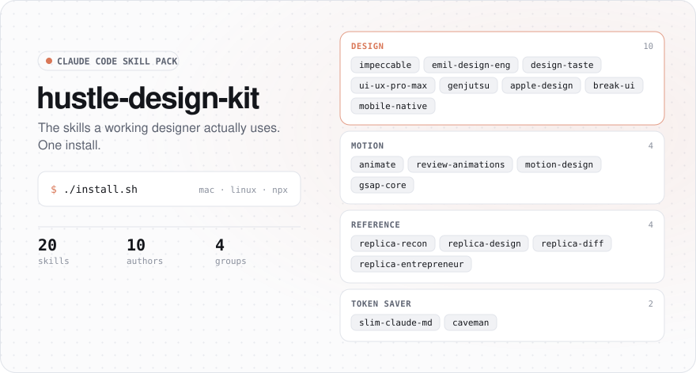

# Hustle Design Kit

<p align="center">
  
  
  
  <a href="LICENSE"></a>
</p>

<p align="center">
  <a href="https://github.com/hustle-x/hustle-design-kit/stargazers"></a>
  <a href="https://github.com/hustle-x/hustle-design-kit/commits/main"></a>
  
  
  
</p>

The Claude Code skills a working designer actually uses, picked from daily client work on websites, apps and motion. One command installs all twenty, straight from the people who wrote them.

<p align="center">
  <picture>
    <source media="(prefers-color-scheme: dark)" srcset="docs/banner-dark.svg">
    <source media="(prefers-color-scheme: light)" srcset="docs/banner-light.svg">
    
  </picture>
</p>

<p align="center">
  <a href="#quick-start">Quick Start</a> ·
  <a href="#how-it-works">How It Works</a> ·
  <a href="#the-skills">The Skills</a> ·
  <a href="#which-skill-when">Which Skill When</a> ·
  <a href="#usage">Usage</a> ·
  <a href="#credits">Credits</a> ·
  <a href="#faq">FAQ</a>
</p>

---

## Quick Start

```bash
git clone https://github.com/hustle-x/hustle-design-kit.git
cd hustle-design-kit && ./install.sh
```

Start a new Claude Code session and the skills are there.

<details>
<summary><b>Windows, or without cloning</b></summary>

Needs Node.js 18+. Run the lines you want:

```bash
npx skills add pbakaus/impeccable -g -a claude-code -s impeccable -y
npx skills add emilkowalski/skills -g -a claude-code -s emil-design-eng apple-design break-ui mobile-native animate review-animations -y
npx skills add Leonxlnx/taste-skill -g -a claude-code -s design-taste-frontend -y
npx skills add nextlevelbuilder/ui-ux-pro-max-skill -g -a claude-code -s ui-ux-pro-max -y
npx skills add AThevon/genjutsu -g -a claude-code -s bunshin cast paint -y
npx skills add LottieFiles/motion-design-skill -g -a claude-code -s motion-design -y
npx skills add greensock/gsap-skills -g -a claude-code -s gsap-core -y
npx skills add Jakeschincariol/replica-skill -g -a claude-code -s replica-recon replica-design replica-diff replica-entrepreneur -y
npx skills add hustle-x/slim-claude-md -g -a claude-code -s slim-claude-md -y
npx skills add JuliusBrussee/caveman -g -a claude-code -s caveman -y
```
</details>

<details>
<summary><b>Let Claude Code do it</b></summary>

```
Install the skill pack from https://github.com/hustle-x/hustle-design-kit
```
</details>

---

## How It Works

Nothing is copied into this repository. The installer asks [`npx skills`](https://www.npmjs.com/package/skills) to fetch each skill from its author, so you get their latest version and they keep the credit.

```
┌─────────────────────────────────────────────────────────────────┐
│  1. YOU RUN                                                     │
│     ./install.sh            (or pick groups: design motion ...) │
└─────────────────────────────────────────────────────────────────┘
                              │
                              ▼
┌─────────────────────────────────────────────────────────────────┐
│  2. ONE FETCH PER AUTHOR (10 repositories)                      │
│     pbakaus/impeccable          emilkowalski/skills             │
│     Leonxlnx/taste-skill        nextlevelbuilder/ui-ux-pro-max  │
│     AThevon/genjutsu            LottieFiles/motion-design       │
│     greensock/gsap-skills       Jakeschincariol/replica-skill   │
│     hustle-x/slim-claude-md     JuliusBrussee/caveman           │
└─────────────────────────────────────────────────────────────────┘
                              │
                              ▼
┌─────────────────────────────────────────────────────────────────┐
│  3. 20 SKILLS IN ~/.claude/skills                               │
│     Claude sees a one-line description of each and loads the    │
│     full skill only when your task needs it.                    │
└─────────────────────────────────────────────────────────────────┘
```

---

## The Skills

### Design · 10

| Skill | What it does | Author |
|:--|:--|:--|
| **impeccable** | Design, critique, audit and polish any interface: hierarchy, layout, type, colour, copy, accessibility | [pbakaus](https://github.com/pbakaus/impeccable) |
| **emil-design-eng** | UI polish and the small details that make software feel great | [emilkowalski](https://github.com/emilkowalski/skills) |
| **design-taste-frontend** | Art direction for landing pages and sites that should not look templated | [Leonxlnx](https://github.com/Leonxlnx/taste-skill) |
| **ui-ux-pro-max** | Searchable library of styles, palettes, font pairs, UX rules and chart types | [nextlevelbuilder](https://github.com/nextlevelbuilder/ui-ux-pro-max-skill) |
| **cast** | genjutsu · motion, micro-interactions and wow-factor on an existing UI | [AThevon](https://github.com/AThevon/genjutsu) |
| **paint** | genjutsu · a complete visual identity and design system | [AThevon](https://github.com/AThevon/genjutsu) |
| **bunshin** | genjutsu · a whole website built by parallel agents (asks before it spends) | [AThevon](https://github.com/AThevon/genjutsu) |
| **apple-design** | Apple-style fluid motion, gestures, springs and materials for the web | [emilkowalski](https://github.com/emilkowalski/skills) |
| **break-ui** | Stress-tests a screen with worst-case data and reports what broke | [emilkowalski](https://github.com/emilkowalski/skills) |
| **mobile-native** | The fixes that make a web app feel installed on a phone | [emilkowalski](https://github.com/emilkowalski/skills) |

### Motion · 4

| Skill | What it does | Author |
|:--|:--|:--|
| **animate** | Builds an animation in the right order: purpose, properties, curve, interruption, exit | [emilkowalski](https://github.com/emilkowalski/skills) |
| **review-animations** | Critiques existing motion and gives exact fixes | [emilkowalski](https://github.com/emilkowalski/skills) |
| **motion-design** | Timing, easing, choreography and Disney principles for UI | [LottieFiles](https://github.com/LottieFiles/motion-design-skill) |
| **gsap-core** | The official GSAP core API skill | [greensock](https://github.com/greensock/gsap-skills) |

### Reference · 4

For "make it like this". Clean-room: features and flows from public pages and your own account, never someone else's code, logo or copy.

| Skill | What it does | Author |
|:--|:--|:--|
| **replica-recon** | Maps a product's screens, flows and controls into a feature checklist | [Jakeschincariol](https://github.com/Jakeschincariol/replica-skill) |
| **replica-design** | Measures screenshots into colour, type and spacing tokens | [Jakeschincariol](https://github.com/Jakeschincariol/replica-skill) |
| **replica-diff** | Scores your version against the reference and lists what is missing | [Jakeschincariol](https://github.com/Jakeschincariol/replica-skill) |
| **replica-entrepreneur** | Reads real public reviews of a product and ranks what its users hate | [Jakeschincariol](https://github.com/Jakeschincariol/replica-skill) |

### Token Saver · 2

| Skill | What it does | Author |
|:--|:--|:--|
| **slim-claude-md** | Moves the history out of a bloated CLAUDE.md word for word, and proves nothing was lost | [hustle-x](https://github.com/hustle-x/slim-claude-md) |
| **caveman** | Short, fluff-free answers when you want fewer tokens | [JuliusBrussee](https://github.com/JuliusBrussee/caveman) |

### Extras

| | |
|:--|:--|
| **graphify** (optional) | Turns a codebase into a knowledge graph so the agent reads less. Needs its own CLI, so it is left out of the default install. Add it with `./install.sh all`. [Graphify-Labs/graphify](https://github.com/Graphify-Labs/graphify) |
| **[CLAUDE.example.md](CLAUDE.example.md)** | Four working rules to paste into your CLAUDE.md: think first, keep it simple, change only what was asked, prove it works. |

---

## Which Skill When

Several design skills overlap on purpose. This is how we pick:

```
┌──────────────────────────────────────┬──────────────────────────────────────┐
│  YOU WANT TO                         │  USE                                 │
├──────────────────────────────────────┼──────────────────────────────────────┤
│  Fix or polish an existing screen    │  impeccable                          │
│  Get the small details right         │  emil-design-eng                     │
│  Design a landing page / site        │  design-taste-frontend               │
│  Pick a style, palette or font fast  │  ui-ux-pro-max                       │
│  Add motion with wow                 │  cast                                │
│  Build a whole visual identity       │  paint                               │
│  Build a whole site from material    │  bunshin                             │
│  Make or review an animation         │  animate · review-animations         │
│  Use GSAP correctly                  │  gsap-core                           │
│  Check a screen with ugly data       │  break-ui                            │
│  Make a web app feel native on phone │  mobile-native                       │
│  Rebuild what a client pointed at    │  replica-recon → design → diff       │
│  Find gaps in a competitor           │  replica-entrepreneur                │
│  Shrink a CLAUDE.md that grew huge   │  slim-claude-md                      │
│  Shorter answers                     │  caveman                             │
└──────────────────────────────────────┴──────────────────────────────────────┘
```

---

## Usage

Just describe the task. Claude picks the skill from its description, or call one by name with a slash.

```
Polish the pricing page, it feels cramped.          → impeccable
/cast add a satisfying hover and press to the cards → cast
The client wants it "like this site": <url>         → replica-recon
My CLAUDE.md is 180 KB, slim it                     → slim-claude-md
```

### Install options

| Command | Installs |
|:--|:--|
| `./install.sh` | design, motion, reference, tokens (20 skills) |
| `./install.sh design motion` | only the groups you name |
| `./install.sh all` | everything, graphify included |
| `./install.sh --project design` | into this project's `.claude/skills` instead of globally |
| `./install.sh --list` | shows what each group installs, installs nothing |

Update later with `npx skills update -g`, remove one with `npx skills remove <name> -g`.

### Supported agents

The installer targets Claude Code. `npx skills` also supports other agents: in the Windows commands above, replace `-a claude-code` with your agent (for example `codex`, `cursor`, `gemini-cli`) or `-a '*'` for all of them.

---

## Credits

Every skill belongs to its author and is installed from their repository. This kit contains only the installer, this README and `CLAUDE.example.md`.

| Repository | Author | License |
|:--|:--|:--|
| [pbakaus/impeccable](https://github.com/pbakaus/impeccable) | Paul Bakaus | Apache-2.0 |
| [emilkowalski/skills](https://github.com/emilkowalski/skills) | Emil Kowalski | MIT |
| [Leonxlnx/taste-skill](https://github.com/Leonxlnx/taste-skill) | Leonxlnx | MIT |
| [nextlevelbuilder/ui-ux-pro-max-skill](https://github.com/nextlevelbuilder/ui-ux-pro-max-skill) | Next Level Builder | MIT |
| [AThevon/genjutsu](https://github.com/AThevon/genjutsu) | Adrien Thevon | MIT |
| [LottieFiles/motion-design-skill](https://github.com/LottieFiles/motion-design-skill) | LottieFiles | MIT |
| [greensock/gsap-skills](https://github.com/greensock/gsap-skills) | GreenSock | MIT |
| [Jakeschincariol/replica-skill](https://github.com/Jakeschincariol/replica-skill) | Jake Schincariol | MIT |
| [JuliusBrussee/caveman](https://github.com/JuliusBrussee/caveman) | Julius Brussee | Apache-2.0 |
| [Graphify-Labs/graphify](https://github.com/Graphify-Labs/graphify) | Graphify Labs | Apache-2.0 |
| [hustle-x/slim-claude-md](https://github.com/hustle-x/slim-claude-md) | hustle-x | MIT |

The rules in `CLAUDE.example.md` are our own wording of Andrej Karpathy's observations on LLM coding mistakes, as collected in [multica-ai/andrej-karpathy-skills](https://github.com/multica-ai/andrej-karpathy-skills).

---

## FAQ

<details>
<summary><b>Will twenty skills eat my tokens?</b></summary>

Only each skill's one-line description is always loaded, roughly 100-200 tokens per skill. The full text loads only when Claude uses that skill.
</details>

<details>
<summary><b>Why not merge them into one big skill?</b></summary>

One big skill would load everything every time it is used. Separate skills load only what the task needs, and each one stays updated by its author.
</details>

<details>
<summary><b>Is the installer safe?</b></summary>

It only runs `npx skills add` for the repositories listed above; read [`install.sh`](install.sh), it is short. Skills run with your agent's permissions, so read a skill before you rely on it, like any code from the internet.
</details>

<details>
<summary><b>Do I need all twenty?</b></summary>

No. Install only the groups you want (`./install.sh design`), or remove single skills with `npx skills remove <name> -g`.
</details>

<details>
<summary><b>Can I suggest a skill?</b></summary>

Open an issue with the link and what you use it for in real work.
</details>

---

## License

The installer, this README and `CLAUDE.example.md` are [MIT](LICENSE). Each skill keeps its own license, listed in [Credits](#credits).

<p align="center">
  <a href="https://star-history.com/#hustle-x/hustle-design-kit&Date">
    <picture>
      <source media="(prefers-color-scheme: dark)" srcset="https://api.star-history.com/svg?repos=hustle-x/hustle-design-kit&type=Date&theme=dark">
      
    </picture>
  </a>
</p>
